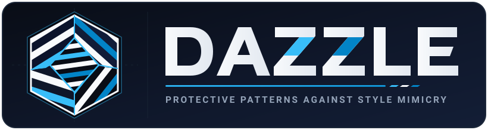
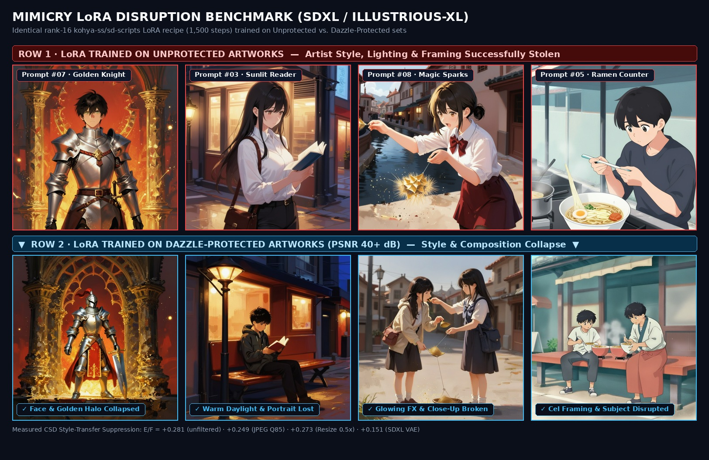
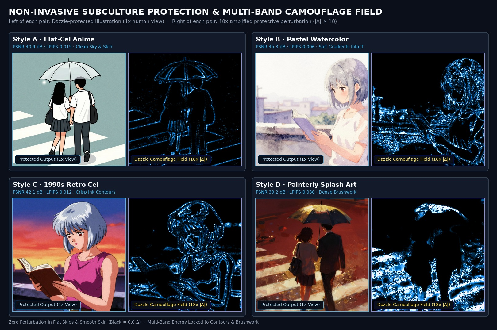

<p align="center">
  
</p>

<p align="center">
  <a href="LICENSE"></a>
  <a href="https://www.python.org/"></a>
  <a href="https://pytorch.org/"></a>
  <a href="https://huggingface.co/bivri/dazzle-generator"></a>
</p>

<p align="center">
  
</p>

> **Effect of Dazzle on Unauthorized Style-Mimicry LoRA Fine-Tuning.**
> - **Row 1 (`Unprotected LoRA`)**: Generations from an SDXL LoRA fine-tuned on unprotected original illustrations.
> - **Row 2 (`Dazzle-Protected LoRA`)**: Generations from a LoRA fine-tuned on Dazzle-protected illustrations (`E/F = +0.281`, `PSNR = 31.9 dB`, `LPIPS = 0.027`).
> - **Row 3 (`Dazzle + VAE Filter`)**: Generations from a LoRA fine-tuned after passing Dazzle-protected images through an SDXL VAE encode-decode transformation filter (`E/F = +0.151`).

---

## What is Dazzle?

Named after **Dazzle Camouflage** (the high-contrast geometric ship patterns designed to disrupt optical rangefinders without concealing the vessel itself), **Dazzle** applies a bounded, non-invasive protective pattern to illustrations so that unauthorized LoRA fine-tuning on latent diffusion models (SDXL family) learns less of the artist's style.

Unlike general-purpose noise that leaves visible grain on flat anime skies, watercolor paper, or character skin, Dazzle shapes its protective signal using **multi-band frequency bounds and collinear RGB exposure gating**:

- **Subculture & Lineart Preservation**: A two-sided valley ink detector and 4-directional ink enclosure isolate interior shading while keeping thin lineart, bare character skin, sunset sky gradients, and white watercolor paper spotless.
- **Zero Hue Shift**: Collinear RGB exposure projection and uniform radial chroma attenuation prevent color-cast blotches or rainbow speckle in dark shadows.
- **Single-Pass Generator & ONNX Support**: A lightweight fully convolutional U-Net (`DazzleGenerator`) emits the bounded protective pattern `delta = epsilon * tanh(G(x))` at native image resolution on GPU or CPU.
- **Transformation-Filter Resilience**: Trained with aspect-ratio bucket resizing, JPEG compression, WebP, and SDXL VAE round trips in the loop.

<p align="center">
  
</p>

> **Non-Invasive Visual Fidelity Across Illustration Styles (`1. Original` vs `2. Dazzle-Protected` and `3x Magnified Crops`).**
> Dazzle maintains `PSNR 34–45 dB` and `LPIPS 0.006–0.062` across **Flat Cel Anime**, **Pastel Watercolor Anime**, **1990s Retro Cel Anime**, and **Painterly Illustrations**.

---

## Quick Start

### Installation

```bash
pip install "bivri-dazzle @ git+https://github.com/bivri/dazzle"
```

Requires **Python 3.11+** and **PyTorch 2.4+**. Optional extras:
- `train`: offline generator training (`pip install "bivri-dazzle[train] @ git+https://github.com/bivri/dazzle"`)
- `eval`: end-to-end LoRA & CSD evaluation harness (`pip install "bivri-dazzle[eval] @ git+https://github.com/bivri/dazzle"`)
- `onnx`: ONNX export (`pip install "bivri-dazzle[onnx] @ git+https://github.com/bivri/dazzle"`)

### Command-Line Usage

```bash
# Protect one or more illustrations at native resolution (outputs PNG)
dazzle protect art.png more-art.jpg --out protected/

# Customize the per-channel intensity bound (in 8-bit levels, default: 20)
dazzle protect art.png --out protected/ --epsilon-levels 12

# Export the generator to ONNX with dynamic height and width axes
dazzle export-onnx --out dazzle.onnx
```

### Python API

```python
from PIL import Image
from dazzle import DazzleGenerator, protect_image

gen = DazzleGenerator.from_pretrained("bivri/dazzle-generator")
protected = protect_image(Image.open("art.png"), gen)
protected.save("art.protected.png")
```

Output is saved as lossless PNG. Re-saving as low-quality JPEG or heavy downscaling weakens the protective pattern.

---

## How It Works

1. **Single-Head Bounded Generator**:
   `DazzleGenerator` is a fully convolutional U-Net that outputs a single tensor `delta = epsilon * tanh(G(x))` at the input illustration's native resolution (reflect-padded to a multiple of 8 and cropped back).
2. **Composite Target-Texture Objective**:
   During training ([`dazzle.training`](src/dazzle/training.py)), the protected image is passed through differentiable transformation filters and encoded by the SDXL VAE (`madebyollin/sdxl-vae-fp16-fix`). The objective pulls the encoded latent and multi-scale feature statistics toward a composite target combining:
   - An **Oklab chiaroscuro counter-bias image** (flattening low-frequency contrast, inverting mid/high luminance bands, and radially attenuating chroma at `0°` hue shift), and
   - A deterministic **procedural CC0 anisotropic structural relief texture**.
3. **Multi-Band Non-Invasive Scalar Hinge Loss**:
   To keep flat backgrounds and delicate lineart untouched without adding auxiliary mask heads to the network, training regularizes `delta` across low-, mid-, and high-frequency bands alongside LPIPS and total variation scalar losses.

---

## Benchmark Summary

Protection effectiveness is measured by **`E/F`** (`effect_ratio` in [CSD](https://huggingface.co/tomg-group-umd/CSD-ViT-L) style space): the fraction of an unprotected LoRA's style-specific gain removed by protection (`1.0` = all style gain removed, `0.0` = no effect), evaluated across 20 held-out prompts against held-out style references ([docs/evaluation.md](docs/evaluation.md)).

| Evaluation Condition | Style | PSNR (dB) | LPIPS | Style Gain Removed (`E/F` [95% CI]) |
| --- | --- | :---: | :---: | :---: |
| **Dazzle Multi-Band Target-Texture** | Flat Cel Anime (`s1`) | 31.90 | 0.027 | **+0.281 [+0.197, +0.355]** |
| **Dazzle + SDXL VAE Round-Trip Filter** | Flat Cel Anime (`s1`) | 28.36 | 0.051 | **+0.151 [+0.077, +0.224]** |
| **Decoy-Latent Baseline** | Flat Cel Anime (`s1`) | 31.85 | 0.108 | +0.138 [+0.084, +0.192] |

| Visual Fidelity Probe Across Styles (`00.png` / `03.png`) | Max Bound ($L_\infty$) | PSNR (dB) | LPIPS |
| --- | :---: | :---: | :---: |
| **Flat Cel Anime (`s1`)** | 20–36 levels | **41.82 – 45.30 dB** | **0.0060 – 0.0187** |
| **Pastel Watercolor Anime (`s2`)** | 24–36 levels | **39.45 – 40.92 dB** | **0.0217 – 0.0357** |
| **1990s Retro Cel Anime (`s3`)** | 28–36 levels | **40.86 – 41.03 dB** | **0.0148 – 0.0177** |
| **Painterly Illustration (`s4`)** | 36 levels | **34.17 – 39.45 dB** | **0.0266 – 0.0617** |

> **Scope & Limitations**: Dazzle is an active research project targeting unauthorized style mimicry via LoRA fine-tuning on latent diffusion models. While flat cel and subculture lineart styles show substantial suppression at imperceptible distortion levels, richly textured painterly styles under strict visibility bounds and reference-based image editing remain open research areas.

---

## Repository Layout

| Path | Description |
| --- | --- |
| [`src/dazzle/`](src/dazzle/) | Core library: `DazzleGenerator`, `protect_image`, training objective, CLI, and evaluation harness |
| [`assets/`](assets/) | Vector SVG logos (`dazzle-logo.svg`, `dazzle-mark.svg`) and visual comparison showcases |
| [`docs/`](docs/) | Evaluation protocol ([`docs/evaluation.md`](docs/evaluation.md)), design records, and contributor guides |
| [`experiments/`](experiments/) | Reproducible experiment records and JSON evaluation reports |
| [`scripts/`](scripts/) | Repository policy checks and Hugging Face Hub model publication script |
| [`tests/`](tests/) | Unit and policy test suite run in CI |

## Contributing

See [CONTRIBUTING.md](CONTRIBUTING.md) and [CONTEXT.md](CONTEXT.md).

## License

Copyright 2026 © LSware. Licensed under the **Apache License, Version 2.0** — see [LICENSE](LICENSE) and [NOTICE](NOTICE).
